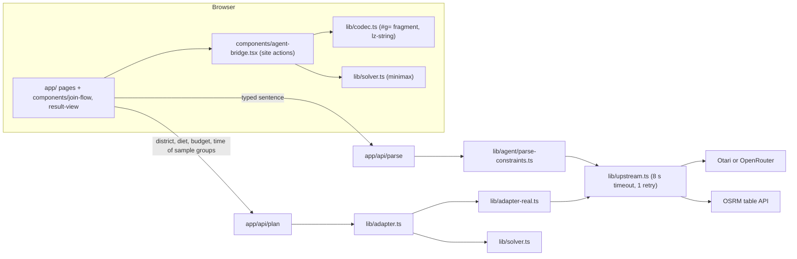

# Mesora

Mesora picks a dinner table for four to eight friends where the longest trip is shortest, instead of the map midpoint that sends one friend on an hour's ride. The whole group lives in one shared link, after the `#`, so no server ever holds who is coming or where from.

**Live:** https://mesora-three.vercel.app. Click "Add yourself to Friday supper" (DEMO.md step 1 to 2), or open https://mesora-three.vercel.app/result/friday-supper and press "Compare with midpoint" (DEMO.md step 4).

## Try it in 60 seconds

1. Open https://mesora-three.vercel.app and scroll: the pinned scene moves four friends' trip bars from the map midpoint (longest trip 74 min) to Mesora's pick (38 min).
2. Press "Add yourself to Friday supper". Type "I'm in Kadıköy, vegetarian, can't leave before 19:00, 400 lira a head max" and press "Let my agent fill it", or click through Area, Diet, Budget and Time. The live preview updates at each step.
3. Press "Add me to the link". `/result/live` decodes the group from the link in your browser.
4. Open `/result/friday-supper` and press "Compare with midpoint": the longest-trip figure and every bar move between 38 and 74 minutes.
5. Open `/about#peer`, press "Ask Mesora for the group plan", then "Allow once". A simulated event site calls `website_solve_plan` and gets the same table.

## Addresses

| What | Where |
| --- | --- |
| Live URL | https://mesora-three.vercel.app |

## Prize track

| Track | Prize | Credits |
| --- | --- | --- |
| First Prize | $5,000 USD | $1,500 USD Otari credits |

This hackathon (Open Agentic Web Challenge) has no sponsor bounty; Mesora enters the automatic First, Second and Third Prize ranking only (see DELIVERY.md).

## The problem

Getting four to eight friends to agree on a place in a big city takes about 40 messages in the group chat, and the same person always ends up organizing. The "meet in the middle" apps that exist average everyone's coordinates or minimize total distance. That sounds fair and is not: one friend rides 15 minutes, another rides 75. In Istanbul the map centre of Kadıköy, Beşiktaş, Bakırköy and Ataşehir lands on the Üsküdar shore, which is a 74 minute trip from Bakırköy.

They also make everyone hand their location and budget to an organizer or a server.

## The solution

A friend sends you a Mesora link. You open it and type one sentence. The agent box turns that into four fields, `website_add_my_constraints` writes them into the link in your browser, and you send it back to the group. When everyone has done the same, the page names a venue and a start time where nobody rides more than about 40 minutes, everyone can eat, and the bill fits the tightest budget.

- **The link is the database.** The group is compressed with lz-string into the URL fragment (after the `#`). Browsers never send the fragment with a request, so our host never sees it. Each person is a first name, a district and the geohash-5 cell (about 5 km) of that district's center, never an address.
- **A solver with no LLM in it.** `website_solve_plan` filters venues by diet, the lowest budget in the group and opening hours for a two hour stay, then picks the venue whose longest trip is shortest (minimax), breaking ties on total minutes.
- **It shows its work.** "Compare with midpoint" moves every trip bar between the Mesora pick and the geographic midpoint, and every rejected venue says why (for example "No vegetarian mains" or "Closes 21:00, before 22:00").

In the seeded Friday supper, the midpoint venue sends Selin on a 74 minute trip. Mesora picks Yenikapı Avlu Mutfak and the longest trip drops to 38.

## Architecture



The fragment never leaves the browser: `/result/live` and the peer call decode it and solve on the seed table in the page.

## How it uses the open agentic web spec

Mesora is shaped as an open agentic website under the Cognizant AI Lab spec (github.com/cognizant-ai-labs/agentic-web):

- `public/agent-manifest.json` declares the site, its capabilities, the entry agent and that it is peer callable.
- `public/mesora.network.json` is the agent network: a `front_man` agent plus three site actions.
- Not in the repo yet: the spec browser runtime `public/agentic/runtime.js` (from the agentify-website skill, pinned to the 11 November 2026 spec commit). The manifest already points at it. Until it is vendored, `node build_network.mjs --check` has not been run and Stage One conformance is unproven.
- `website_add_my_constraints`, `website_solve_plan` and `website_get_link` change real page state: the link, the plan and the share URL (`components/agent-bridge.tsx`, registered on `window.mesoraSiteActions`).
- Peer call, simulated: `/about#peer` (`components/peer-call.tsx`) shows an event site's agent asking for consent, then calling `website_solve_plan` with the Friday supper link and getting back the same venue and the same 38 vs 74 minutes. It runs in the same page through `siteActions`, not across origins.

## Privacy: what leaves the browser

- **Nobody** gets the link fragment after the `#`, where the group lives.
- **Our server** gets the sentence typed in the agent box (`POST /api/parse`, never logged; the parsed four fields are cached in memory for ten minutes, keyed by a sha1 of the sentence). For the two sample groups only, it also solves district, diet, budget and time (`/api/plan`, names dropped).
- **Otari or OpenRouter** get that typed sentence, only when `OTARI_API_KEY` or `OPENROUTER_API_KEY` is set on the deployment. With no key, a rule parser reads it on our server.
- **The public OSRM server** gets district center and venue coordinates (`ADAPTER_MODE=real` only). Never a name, the link or an address.

Type a district, not a street address, in the agent box: whatever you type goes to the parse route.

## Tech stack

Installed (versions as in `package.json`):

- Next.js 15 (`^15.4.5`, App Router), React 19 (`^19.1.0`), TypeScript 5
- Tailwind CSS 4 (`^4.1.11`), with small primitives built on class-variance-authority 0.7 and @radix-ui/react-slot 1
- GSAP 3 (`^3.15.1`) with ScrollTrigger, through @gsap/react 2: the pinned before/after scene, the home headline intro and the "Compare with midpoint" tween
- lz-string 1 (`^1.5.0`) for the fragment codec, plus a built-in geohash encoder
- zod 3 (`^3.25.0`) for request validation in the JSON routes
- Node's built-in test runner (`node:test`) with type stripping for the travel and codec tests
- Fonts: Sora and Nunito Sans through `next/font/google`

External service, no package: the OSRM `table` HTTP API (keyless public server by default) for driving minutes.

Not installed and not built: Leaflet, opening_hours.js, an Overpass client, the spec runtime file.

## Real vs sample data

**What the live URL runs:** the result page says it in one line. It reads "Sample data" unless the line reads "Live source" (`ADAPTER_MODE=real` with OSRM answering).

Venues, prices, opening hours, diet flags and the two sample groups are seed data in `lib/data/seed.ts`. The only live data is OSRM driving minutes, and only when `ADAPTER_MODE=real`. The home scene always uses the seed table, so it always shows 74 vs 38. The peer call on `/about#peer` is simulated in the page.

`ADAPTER_MODE` picks the adapter, and `lib/config.ts` is the only file that reads it. `fake`, the default, uses the seeded Istanbul data with its cached travel table. `real` asks OSRM for driving minutes from each district center to each venue, in one `table` request per solve, cached in memory for ten minutes. If OSRM does not answer within 8 seconds plus one retry, Mesora estimates straight-line km x 1.4 at 25 km/h, sets `travelSource: "estimate"` and the result page says so. `/result/live` always solves in the browser from the link and calls no API.

Every failure from `/api/groups/[id]`, `/api/plan` and `/api/parse` has the shape `{ "ok": false, "error": "<code>", "hint": "<one readable line>" }` (`lib/errors.ts`).

## Quickstart

```bash
npm install
cp .env.example .env.local
npm test
npm run proof
npm run dev
```

Every key in `.env.example` is optional. `npm run seed` and `npm run demo:reset` check the seed and write nothing; there is no server state to reset, because the group lives in the link. Set `ADAPTER_MODE=real` in `.env.local` to see live OSRM minutes on `/result/friday-supper`.

Agent paths, in order: Otari when `OTARI_API_KEY` and `OTARI_BASE_URL` are set, then OpenRouter when `OPENROUTER_API_KEY` is set, then your local `claude` CLI in development, then a deterministic rule parser.

## Proof

`npm run proof` rewrites the three blocks below. The files in `fixtures/osrm/` are hand-written examples of the OSRM table response shape for the unit tests, not recordings of real calls; the live numbers are only the ones in the OSRM block.

### OSRM table call

<!-- PROOF:BEGIN osrm -->
Run on 2026-11-24 against https://router.project-osrm.org (driving profile), one `table` request, latency 285 ms.

| From district center | Harem Sahil Çay Bahçesi | Yenikapı Avlu Mutfak |
| --- | --- | --- |
| Kadıköy | 8 min | 12 min |
| Beşiktaş | 18 min | 13 min |
| Bakırköy | 25 min | 12 min |
| Ataşehir | 14 min | 18 min |
<!-- PROOF:END osrm -->

### Demo path

Three `POST /api/plan` calls of Friday supper in a row against `PROOF_BASE_URL` (set it to the deployed URL). On the seed table the pick's longest trip is 38 min against 74 at the map midpoint; in real mode the minutes are live OSRM.

<!-- PROOF:BEGIN demo-path -->
Not run in this build: PROOF_BASE_URL not set.
<!-- PROOF:END demo-path -->

### Tests

<!-- PROOF:BEGIN tests -->
Run on 2026-11-24 with `node --experimental-strip-types --test tests/*.test.mjs` on Node 22.23.3: 15 passed, 0 failed.
<!-- PROOF:END tests -->

## What we would build next

1. Live venues from Overpass with opening hours parsed by opening_hours.js (trip times already come from OSRM in real mode).
2. A Leaflet map with every friend's cell and the candidate venues, greying out the ones a filter dropped.
3. Move the simulated peer call on `/about#peer` to a real companion event site on its own origin, once the spec runtime is vendored.
4. Publishing the fragment codec and the minimax solver as an npm package so other planners can reuse them.

## AI use

The hackathon's rules ask that narration in the demo be the entrant's own and set "no rule on AI tools in code". We used AI coding assistants for scaffolding, boilerplate and parts of the interface code. Product decisions, the solver design and final review are our own. At runtime, an LLM (Otari or OpenRouter, when a key is set) only turns one typed sentence into four form fields; the venue choice is plain code.

## License

MIT, see `LICENSE`.
